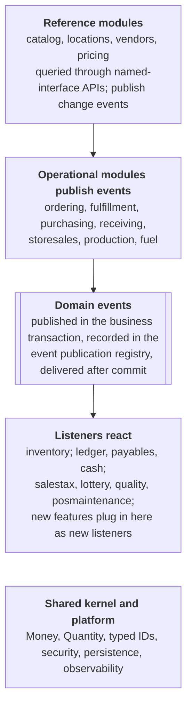

# Retail Operations Platform PRD

Last updated: 2026-11-10

## Overview

We will build one deployable Kotlin and Spring Boot application, organized as a Spring Modulith modular monolith, that runs store ordering, warehouse fulfillment, purchasing, receiving, pricing and promotions, store sales import from the point-of-sale (POS) system, and the accounting entries those activities create.

**Problem.** These capabilities are spread across separate systems today, so a store order, a vendor delivery, or a day of sales has to be reconciled by hand between operations and accounting. Each new feature touches several systems and integrations.

**Goals**

1. One source of truth for items, prices, orders, inventory movements, and the financial entries they create.
2. Every business fact that moves money or stock is captured as a domain event and posted to the general ledger automatically, and the general ledger in this system is the book of record.
3. Module boundaries strong enough that any module could later be extracted into its own service without rewriting its business logic.
4. New features (new order types, promotion types, vendors, file formats) are added by adding code in one module, not by editing many.
5. Business logic contains no input validation and no framework code. It receives types that are already valid.

**Non-goals for the first release**

- Register (POS) software. A third-party POS runs the registers; we consume its end-of-day file.
- Payroll and fixed asset subledgers. Their results post to the general ledger as journal entries; the source systems are open questions.
- Customer-facing ecommerce, loyalty, or labor scheduling.
- A microservice deployment. The system ships as one container that scales horizontally.

## Scope and business capabilities

The first release covers two value streams: **order to store** (a store orders, the warehouse picks and ships, the store receives) and **procure to pay** (we buy from a vendor, the vendor delivers to the warehouse, we accrue the cost and later match the invoice). Store sales from the POS feed both inventory and accounting.

| Capability | What users can do | Primary users |
| --- | --- | --- |
| Store ordering | Create, edit, submit, and cancel store orders; generate suggested orders from par levels; set order cutoff times per store and delivery route | Store managers, replenishment analysts |
| Fulfillment: picking | Release orders into pick waves, assign pick tasks by zone, record picked and short quantities, substitute items when allowed | Warehouse supervisors, pickers |
| Fulfillment: shipping | Build loads by route, assign trucks, print manifests, confirm dispatch, record store proof of delivery | Transportation, drivers, stores |
| Purchasing | Create purchase orders to vendors, manage vendor delivery schedules and lead times, approve POs over thresholds, send POs to vendors | Buyers |
| Receiving | Receive against a PO at the warehouse dock, record over, short, and damaged quantities, put product away | Receiving clerks |
| Inventory | Maintain on-hand by location (warehouse and each store) as an append-only movement ledger; adjustments and cycle counts | Inventory control |
| Accounting | Maintain the chart of accounts and general ledger; post every journal; accrue on receipt, match invoices, release and pay vouchers; reconcile store cash, card settlements, and bank accounts; produce trial balance and financial statements; close periods | Accounting, AP |
| Fuel | Maintain tanks and grades per store; record fuel deliveries and supplier invoices; relieve tank inventory from nightly fuel sales; reconcile book versus measured inventory and post variances; set fuel prices | Fuel team, stores, accounting |
| Lottery | Track instant ticket packs, reconcile store lottery sales and validations to the weekly state lottery settlement, record commissions | Accounting, stores |
| Sales tax | Maintain jurisdictions and rates; summarize taxable and exempt sales by jurisdiction; prepare state sales tax returns ready to file; record payments | Tax accountant |
| Direct store delivery | Record beverage and snack vendor deliveries and returns at stores; match vendor invoices to receipts and agreed costs; track vendor-funded promotions | Store managers, buyers, AP |
| Production | Maintain recipes; plan and run production orders for company-made products; track lots and expiry; place holds and run recalls; cost finished goods | Plant managers, quality, cost accounting |
| Quality | Define quality specifications per product; record test results and food safety checks; hold and release lots; run recalls | Quality manager, lab and plant staff |
| Pricing and promotions | Maintain base retail prices by zone or store with effective dates; create promotions (percent off, amount off, buy X get Y, mix and match, price point); schedule price changes; send items, prices, and promotions to the POS registers | Pricing team, merchandising |
| Store sales import | Ingest POS end-of-day files per store, reconcile totals, post sales to inventory and accounting, keep raw files for audit | Automated, with an exceptions queue for accounting |
| Master data | Items, units of measure and pack sizes, vendors, stores, warehouses, delivery routes | Merchandising, master data team |

## Architecture

One deployable and one database hold strictly separated business modules that change state only inside their own boundary and announce what happened through events.



Modules talk through recorded events, never through each other's tables.

Operational modules publish events, inventory and accounting react to them, and new features attach as new listeners without touching the publishers. Ordering and purchasing also listen to some events, as the module table below shows.

**Architecture rules**

- **Module boundaries are verified.** Each module declares its allowed dependencies in `package-info.kt` with `@ApplicationModule`. Only the `api` named interface is visible to other modules, and `ApplicationModules.verify()` fails the build on a violation or cycle.
- **Events over calls.** A module that reacts to a change in another module listens for its event. Synchronous calls are allowed only for queries through the other module's `api` facade (for example, ordering asks pricing for a current price), never for commands.
- **Hexagonal inside every module.** `domain` (pure Kotlin) sits at the center, `application` holds use cases and ports, and `adapter` holds REST controllers, event listeners, and persistence. Dependencies point inward only.
- **Commands in, events out.** Every write is a command handled by one use case in one transaction, producing state changes and domain events. Reads use query services that may return read-model DTOs directly from SQL.
- **No shared mutable state.** Modules share only the `shared` kernel (immutable value types) and the `platform` infrastructure.
- **Time is injected.** All code reads time from an injected `Clock`, so cutoffs, effective dates, and period closes are testable.

## Module specifications

Each row is one Spring Modulith application module (a top-level package under `com.<company>.retail`). A module owns its aggregates and tables outright; other modules see it only through its published API package and its events.

| Module | Owns (aggregates and key concepts) | Publishes | Consumes |
| --- | --- | --- | --- |
| `catalog` | Item, unit of measure, pack size and conversions, item hierarchy (department, category), vendor item (vendor SKU, case pack, list cost) | ItemCreated, ItemChanged, VendorCostChanged, ItemDiscontinued | None |
| `locations` | Store, warehouse, delivery route, route stop schedule, order cutoff time | StoreOpened, StoreClosed, RouteScheduleChanged | None |
| `vendors` | Vendor, remit-to address, payment terms, vendor contacts | VendorCreated, VendorTermsChanged | None |
| `pricing` | Price zone, retail price (effective dated), promotion (typed, scheduled), price resolution | RetailPriceScheduled, PriceChangeEffective, PromotionScheduled, PromotionEnded | ItemCreated, ItemDiscontinued, StoreOpened |
| `ordering` | Store order (Draft, Submitted, Released, Cancelled, Closed), order line, par level, suggested order | StoreOrderSubmitted, StoreOrderReleased, StoreOrderCancelled | ItemDiscontinued, OrderPicked, ShipmentDelivered, StockBelowPar |
| `fulfillment` | Pick wave, pick task, load, shipment, proof of delivery | OrderPicked (with shorts and substitutions), ShipmentDispatched, ShipmentDelivered | StoreOrderReleased, StoreOrderCancelled |
| `purchasing` | Purchase order (Draft, Approved, Sent, Partially received, Closed, Cancelled), approval policy, vendor delivery schedule, lead time, suggested PO | PurchaseOrderApproved, PurchaseOrderSent, PurchaseOrderClosed, PurchaseOrderCancelled | VendorCostChanged, GoodsReceived, StockBelowPar |
| `receiving` | Receipt (against a PO at a warehouse or plant), receipt line with over, short, and damaged quantities, put-away task; direct store delivery receipt at a store, with returns and vendor credits | GoodsReceived (quantities and PO unit cost), ReceiptDiscrepancyRecorded | PurchaseOrderSent |
| `inventory` | Inventory movement (append-only ledger), on-hand projection by item and location, adjustment, cycle count | InventoryAdjusted, StockBelowPar | GoodsReceived, ShipmentDispatched, ShipmentDelivered, StoreSalesDayPosted |
| `ledger`, `payables`, `cash` | Ledger: chart of accounts, journals, journal entries, posting rules, fiscal periods. Payables: vendor invoices, three-way match, accruals, vouchers, payments. Cash: store cash, deposits, card settlement, bank reconciliation. Detail in Accounting and general ledger | JournalEntryPosted, PeriodClosed, AccrualRecorded, InvoiceMatched, InvoiceMatchException, PayableVoucherReleased, PaymentIssued, DepositReconciled, CashOverShortRecorded | GoodsReceived, ReceiptDiscrepancyRecorded, ShipmentDispatched, StoreSalesDayPosted, StoreSalesDayCorrected, InventoryAdjusted, plus each other's events (for example PaymentIssued posts in ledger) |
| `fuel` | Fuel grade (including blends such as Plus at 50% regular and 50% premium), store tank, tank reading and detected delivery (imported from the tank monitoring system through a TankMonitoringGateway port), fuel delivery (bill of lading), fuel price, wet-stock reconciliation (book versus measured inventory), fuel cost by tank. Quantities and unit prices keep 3 decimals | FuelDelivered, FuelPriceChanged, TankReconciled, FuelVarianceRecorded | StoreSalesDayPosted (gallons by grade relieve tanks, blends split by ratio), StoreOpened |
| `lottery` | Instant ticket packs (received, activated, settled), lotto sales, validations paid, weekly settlement with the state lottery, commissions | LotterySettlementRecorded, LotteryVarianceRecorded | StoreSalesDayPosted (LOTO lines and validation paid-outs) |
| `salestax` | Tax jurisdictions and rates with effective dates, POS tax level mapping per store, taxable and exempt sales by jurisdiction, returns and filing periods, payments | SalesTaxReturnPrepared, SalesTaxReturnFiled | StoreSalesDayPosted, StoreSalesDayCorrected, StoreOpened |
| `posmaintenance` | Outbound XML maintenance files to the POS: item, price, promotion (mix and match, combos), and fuel price changes per store, with delivery status and acknowledgment | PosMaintenanceSent, PosMaintenanceFailed | ItemCreated, ItemChanged, PriceChangeEffective, PromotionScheduled, PromotionEnded, FuelPriceChanged |
| `production` | Plant, production line, recipe (bill of materials, versioned), production order, batch and lot with expiry, quality hold, recall, labor and overhead rates | ProductionOrderReleased, ProductionCompleted, ProductionVarianceRecorded | GoodsReceived (raw materials at a plant), ItemCreated, ItemChanged |
| `quality` | Product quality specification (tests, target ranges, frequency), test result, lot quality status, critical control point log, recall with disposition per shipment | LotPlacedOnHold, LotReleased, LotRecalled, QualityCheckMissed | ProductionCompleted, GoodsReceived (raw material lots), ShipmentDispatched (for recall trace) |
| `storesales` | Sales file (raw, hashed), store sales day, sales line, tender line, reconciliation result, import exception | StoreSalesDayPosted, StoreSalesDayCorrected, SalesFileRejected, SalesFileMissing | StoreOpened, StoreClosed |
| `shared` | Shared kernel: Money, Quantity, UnitOfMeasure, typed IDs, BusinessDate, fiscal calendar types | None | None |
| `platform` | Cross-cutting infrastructure (open module): security, persistence config, clock, idempotency, observability, error mapping | None | None |

## Accounting and general ledger

This system is the company's book of record. Every financial fact enters the general ledger through a balanced journal entry, and the trial balance, financial statements, and period close all come from here. Nothing is exported to an outside finance system, including payable vouchers, which are paid from this system.

**Accounting modules**

| Module | Owns |
| --- | --- |
| `ledger` | Chart of accounts, fiscal calendar and periods, journals, posting rules, journal entries, account balances, trial balance, financial statements, manual and recurring entries, period close |
| `payables` | Vendor invoices, three-way match, goods-received-not-invoiced accruals, payable vouchers, payment runs, payments, vendor credits, aging |
| `cash` | Store cash (drawers, safe, deposits in transit, over and short), card settlement by network, bank accounts, bank statement import, bank reconciliation |

Operational modules never write to the ledger directly. `ledger` subscribes to their events and turns each one into journal entries through a posting rule (Strategy pattern, one rule per event type), so a new kind of transaction is a new rule.

**Chart of accounts and journals**

- The current chart of accounts is migrated, with opening balances loaded at cutover. Account strings keep the current chart's segments, mapped to company, natural account, location (store, warehouse, or office), and department, for example `01-4010-0101-52`. Segment values are master data with effective dates. Valid combinations are controlled by rules, not by listing every combination.
- Journals: Sales (store sales days), Inventory (receipts, transfers, adjustments, cost of goods), Purchases (accruals and vendor invoices), Cash receipts (store deposits, card settlements), Cash disbursements (vendor payments), General (manual), Recurring, Reversing, and Closing.
- Every journal entry records its journal, business date, fiscal period, source module, source event ID, and source document, and it must balance before it is saved.

**Fiscal calendar.** The company closes on a 4-4-5 calendar: each quarter has periods of 4, 4, and 5 weeks, every period ends on the same weekday, and a 53rd week is added in some years. The calendar is generated from rules (year start, period-end weekday, 53rd-week placement) and stored as data, so business date to fiscal period is a lookup, never a calculation scattered through the code.

**Posting rules for a store sales day** (from the NAXML file)

| Source in the file | Debit | Credit |
| --- | --- | --- |
| Merchandise sales by department | Tender accounts below | Sales, by store and department |
| Fuel sales by grade | Tender accounts below | Fuel sales, by store and grade |
| Sales tax by tax level | Tender accounts below | Sales tax payable, by jurisdiction |
| Container deposits (`CDEP`) | Tender accounts below | Bottle deposit liability |
| Instant and lotto tickets sold (`LOTO`) | Tender accounts below | Lottery payable |
| Lottery validations paid | Lottery payable | Store cash |
| Gift certificate sold or redeemed | Tender, or gift certificate liability | Gift certificate liability, or sales |
| Cash tendered less change | Store cash (safe) | (sales lines above) |
| Credit and debit tenders | Card settlement receivable, by network | (sales lines above) |
| EBT tenders | EBT receivable | (sales lines above) |
| Drive-offs (`DRVO`) | Drive-off loss | (sales lines above) |
| Paid-outs and pay-ins | Account mapped from the reason code, or store cash | Store cash, or account mapped from the reason code |
| Cost of items sold | Cost of goods sold, by store and department | Store inventory |

**Other posting rules**

| Business event | Debit | Credit |
| --- | --- | --- |
| Goods received at the warehouse | Warehouse inventory | Accrued payables (GRNI) |
| Shipment dispatched to a store | Store inventory (in transit) | Warehouse inventory |
| Vendor invoice matched | Accrued payables, purchase price variance | Accounts payable |
| Vendor payment | Accounts payable | Bank, purchase discounts taken |
| Store deposit cleared at the bank | Bank | Store cash (deposit in transit) |
| Card settlement deposited | Bank, card processing fees | Card settlement receivable |
| Cash over or short | Cash over and short, or store cash | Store cash, or cash over and short |
| Inventory adjustment (shrink, damage, count) | Shrink expense | Inventory |
| Year-end close | Income and expense accounts | Retained earnings |

**Fuel, lottery, and sales tax postings**

| Business event | Debit | Credit |
| --- | --- | --- |
| Fuel delivered to a store tank | Fuel inventory, by store and tank | Accrued fuel payable |
| Fuel supplier invoice matched | Accrued fuel payable, fuel taxes | Accounts payable |
| Cost of fuel sold | Fuel cost of goods sold, by store and grade | Fuel inventory |
| Tank reconciliation variance | Fuel shrink (or gain) | Fuel inventory |
| Lottery weekly settlement | Lottery payable, lottery commission receivable | Bank (sweep), lottery commission income |
| Sales tax return filed and paid | Sales tax payable, by jurisdiction | Bank |

**Inventory cost.** Merchandise uses weighted average cost by item and location, recalculated on each receipt and transfer in. Store cost comes from the warehouse cost at the time of shipment. Fuel uses weighted average cost by store and tank, recalculated on each delivery.

**Store cash and deposits.** Stores take their own deposits to the bank. The store enters each deposit (amount, date, deposit slip number) in this system. Expected cash for the day is cash tendered, less change, paid-outs, and lottery validations, plus pay-ins, adjusted for the change fund. The difference between the deposit and expected cash posts to cash over and short by store. The deposit sits in deposit in transit until the bank statement import matches it, and unmatched or late deposits alert accounting.

**Payables and payments**

- A payable voucher is released only after a successful three-way match, or after an approved override by someone other than the invoice's creator.
- Payment runs select released vouchers by due date and payment terms, take early-payment discounts when they are worth taking, and need approval before release.
- Payments go out from this system as ACH (NACHA files sent to the bank) or as printed checks with MICR encoding, and every check run produces a positive pay file for the bank. Voided and stop-paid payments reverse their entries and update positive pay.
- AP aging by vendor, and vendor 1099 reporting if required.

**Controls and close**

- Journal entries are immutable. Corrections are reversals plus new entries (see Data, persistence, and accounting integrity).
- Manual journal entries need a second user's approval above a configurable amount, and recurring entries post from approved templates.
- Subledgers reconcile to their control accounts daily: AP aging to accounts payable, open receipts to GRNI, inventory valuation to inventory accounts, store cash to cash accounts, and open card batches to card settlement receivable. Any difference raises an alert.
- Bank statements are imported daily (for example BAI2) and matched automatically to deposits, card settlements, and payments. Unmatched items go to a reconciliation queue.
- Reports: trial balance as of any date; balance sheet and income statement by company, store, and department; store profit and loss; sales tax by jurisdiction. Every balance drills down to journal entries, then source documents, then the original NAXML transaction or vendor invoice.
- Period close follows a checklist: all store days posted, card settlements and bank accounts reconciled, accruals reviewed, recurring entries posted. Then a soft close (adjustments only) and a hard close (locked).

## Direct store delivery and production

Two product flows bypass the warehouse purchasing path. Beverage and snack vendors deliver straight to stores, and the company makes some of its own branded food products in its own plant. Both flows feed the same inventory ledger, weighted average cost, and general ledger as everything else.

**Direct store delivery (DSD)**

- The vendor's route driver delivers, stocks the shelf, and picks up out-of-date product. The store keeps the vendor's delivery receipt (the driver's printed ticket), and the manager records it in this system, including returns. Today accounting matches that receipt to the vendor's invoice by hand; the system takes over that match.
- DSD has no purchase order. The vendor's invoice, however it arrives, is matched two ways: to the store receipt (quantities) and to the agreed cost list for that vendor and item (prices). Differences go to an exception queue for the buyer.
- Returns and out-of-date pickups become vendor credits, so payables nets them against invoices.
- DSD items stay in the catalog with a vendor and cost, so store sales relieve them from inventory and cost of goods posts like any other item.
- Vendor-funded promotions (for example a beverage vendor's price reduction that the vendor pays for) are tracked as vendor funding receivable and billed or deducted.

**Production (company-made products)**

- The company has one production plant and one warehouse, each a location; the model still allows more. Branded products are sold only through the company's stores, so there is no outside customer billing. Raw materials (ingredients and packaging) are bought through `purchasing` and received into the plant like any warehouse receipt.
- Each product has a versioned recipe (bill of materials): ingredients with quantities, packaging, expected yield, and the production line it runs on.
- A production order moves from planned to released, in progress, and completed. Completion records the actual ingredients used and actual output, so yield and usage variances are measured, not assumed.
- Every finished batch gets a lot number with production and expiry dates. Raw material lots are recorded on the batch, giving full trace from a supplier lot to every store that received the product. Fulfillment picks the earliest expiry first.
- A lot can be put on quality hold, which blocks picking until it is released, and a recall lists every affected shipment and store.
- Finished goods cost is the actual ingredient cost (weighted average) plus labor and overhead charged at a rate per line hour. Finished goods then move to the warehouse at that cost and follow the normal order-to-store flow.
- Events: ProductionOrderReleased, ProductionCompleted (ingredients used and output produced, with lots and costs), ProductionVarianceRecorded. Hold, release, and recall events come from the quality module.

**Quality and food safety**

The plant has no system for recipes or quality today, so both are built here. Quality is its own module (`quality`) so that release decisions stay separate from the people running production.

- Each product has a quality specification: the required tests (for example composition, temperature, process time and temperature, weight checks, lab tests), target ranges, and how often each is taken.
- Plant and lab staff record results against the lot. Instrument imports can be added later as adapters.
- Every new lot starts on quality hold. It is released automatically when all required tests pass. An out-of-range or missing result keeps it on hold and alerts the quality manager, and releasing a lot despite a failed test needs a second person's approval.
- Food safety checks at critical control points are logged with time, value, and person. A missed or out-of-range check raises an alert.
- A recall starts from any lot (raw material or finished) and lists every affected batch, shipment, and store, with a recorded disposition for each.
- All quality records are immutable, audited, and kept for the retention period the plant must meet.

**Postings**

| Business event | Debit | Credit |
| --- | --- | --- |
| DSD delivery received at a store | Store inventory | Accrued DSD payable |
| DSD vendor invoice matched | Accrued DSD payable, cost variance | Accounts payable |
| DSD return or out-of-date pickup | Accounts payable (vendor credit) | Store inventory |
| Raw materials issued to production | Work in process | Raw materials inventory |
| Labor and overhead charged to production | Work in process | Labor and overhead absorbed |
| Production completed | Finished goods inventory | Work in process |
| Yield or usage variance | Production variance | Work in process (or the reverse) |
| Lot written off (recall or expiry) | Product write-off expense | Finished goods or store inventory |

## Fuel and tank monitoring

A third-party tank monitoring system watches every store's tanks. The `fuel` module imports its readings and reconciles each tank's measured inventory against book inventory built from deliveries and POS fuel sales.

**Tank monitoring reading layout**

| Source column (either name) | Type | Maps to |
| --- | --- | --- |
| `Site_ID` or `Facility_Num` | String or integer | Store, through a maintained site mapping |
| `Timestamp` or `Reading_Date` | Date and time (`YYYY-MM-DD HH:MM:SS`) | Reading time, stored in UTC with the store's time zone |
| `Tank_ID` or `Tank_Num` | Integer | Store tank |
| `Product_Name` or `Grade` | String (for example `UNL 87`, `DSL`) | Fuel grade, through a product mapping checked against the tank's grade |
| `Gross_Volume` | Decimal | Gross volume |
| `Net_Volume` or `TC_Volume` | Decimal | Temperature-compensated volume, used for all wet-stock math |
| `Fuel_Height` or `Product_Level` | Decimal | Product height |
| `Water_Level` or `Water_Height` | Decimal | Water height |
| `Water_Volume` | Decimal | Water volume |
| `Temperature` | Decimal | Average fuel temperature |

**Import rules**

- The adapter accepts either column name and normalizes units to gallons, inches, and degrees Fahrenheit. The unit for each site is configured, because the file does not label it.
- A reading is unique by site, tank, and timestamp, so re-sent readings are ignored.
- An unknown site, tank, or product, or a product that does not match the tank's grade, goes to an exception queue.
- Volumes are stored as decimals with 3 places, never as floating point.

**Wet-stock reconciliation (per tank, per business day)**

- Book closing = measured opening (net volume) + deliveries - gallons sold. Gallons sold come from the NAXML fuel lines for that store and day, with blended grades split across their source tanks by blend ratio.
- Variance = measured closing - book closing. It posts to fuel shrink or gain and is tracked as a running total per tank.
- Thresholds are configurable per tank (gallons and percent of sales). A breach, a sustained loss trend, or water above its limit alerts the fuel team.
- A delivery shown by a volume increase in the tank readings with no recorded delivery, or the reverse, is flagged for follow-up.

## Event catalog and integration rules

Modules integrate through Spring application events published inside the business transaction and recorded by the Spring Modulith event publication registry, so no event is lost if a listener fails or the container restarts.

**Event rules**

- Events are immutable Kotlin data classes named in the past tense, placed in the publishing module's `api.events` package (a Spring Modulith named interface).
- Every event carries `eventId`, `occurredAt`, `businessDate`, and `schemaVersion`, plus the business keys and the facts consumers need. Consumers never call back into the publisher to complete an event.
- Aggregates register events (`AbstractAggregateRoot` style or an explicit domain event list); the application service publishes them after the state change in the same transaction.
- Cross-module listeners use `@ApplicationModuleListener` (asynchronous, after commit, in its own transaction). Synchronous listeners are not used across modules.
- Every listener is idempotent: it records `eventId` in a per-module processed-events table, or the handler is naturally idempotent by business key.
- Failed publications are retried by the registry's resubmission API on a schedule, and stale publications are marked failed and alerted on. Completed publications are archived after 30 days.
- Breaking changes to an event ship as a new type or a new `schemaVersion`; consumers handle the old version until all publications of it have completed.
- Events that leave the process later (to Azure Service Bus) are marked with `@Externalized`. Nothing is externalized in the first release.

**Primary flows**

| Flow | Event chain |
| --- | --- |
| Order to store | StoreOrderSubmitted, then StoreOrderReleased (at route cutoff), then OrderPicked, then ShipmentDispatched (inventory moves to in transit; accounting transfers cost), then ShipmentDelivered (store on-hand increases; order closes) |
| Procure to pay | PurchaseOrderApproved, then PurchaseOrderSent, then GoodsReceived (inventory increases; accounting accrues), then InvoiceMatched or InvoiceMatchException, then PayableVoucherReleased |
| Store sales | SalesFile received, then StoreSalesDayPosted (inventory decreases; accounting posts sales, tax, tender, and cost of goods), then StockBelowPar (feeds suggested orders) |
| Price change | RetailPriceScheduled, then PriceChangeEffective on its effective date (`posmaintenance` exports it to the POS) |

## Validation strategy

Input validation happens only at the edges of the system; application services and domain code never check whether their inputs are well formed, because they only receive types that cannot be invalid.

| Layer | Responsibility | Mechanism |
| --- | --- | --- |
| Inbound adapter (REST, file parser, scheduler) | Shape and format: required fields, lengths, formats, ranges | Jakarta Bean Validation on request DTOs with `@Valid`; custom constraint annotations for reusable formats (`@StoreNumber`, `@Upc`, `@VendorNumber`); file parsers return a typed parse result with line errors |
| Mapping (adapter to command) | Turn primitives into domain types | DTO `toCommand()` functions build value objects; a failure becomes a 400 response, never reaches the service |
| Value objects (`shared` and module domain) | Type invariants that are always true | Kotlin `@JvmInline value class` and data classes with private constructors and factory functions: `Money`, `Quantity`, `Upc`, `StoreNumber`, `Percentage`, `DateRange` |
| Domain model | Business rules that depend on state | Aggregate methods and policies (`PoApprovalPolicy`, `OrderCutoffPolicy`) that return domain results or throw a typed `BusinessRuleViolation`. These are business decisions, not validation |
| Database | Integrity under concurrency | Unique and check constraints, optimistic locking with `@Version`; violations map to 409 responses |

**Rules enforced by the build**

- No `jakarta.validation`, `org.springframework.web`, or persistence annotations in any `domain` package (ArchUnit test).
- Commands and domain methods accept value objects, never raw `String` or `Int` for business identifiers, money, or quantities (code review plus Detekt custom rule).
- One `@RestControllerAdvice` maps validation failures, `BusinessRuleViolation`, concurrency conflicts, and not-found errors to RFC 9457 Problem Details with a stable `type` URI and error code per case.
- Expected business outcomes that callers must handle (for example, an invoice that fails matching) are modeled as sealed result types rather than exceptions.

## Technology stack and decisions

The stack is Kotlin on Java 25 with Spring Boot 4.x and Spring Modulith 2.x, persisted with Spring Data JDBC on PostgreSQL and hosted on Azure Container Apps. Versions are pinned in a Gradle version catalog to the latest GA releases at project start; as of this writing Spring Boot 4.1 is the current line ([source](https://www.herodevs.com/blog-posts/spring-boot-versions-eol-dates-and-latest-releases-april-2026)).

| Concern | Choice | Why |
| --- | --- | --- |
| Language and runtime | Kotlin 2.x, Java 25 (LTS, Eclipse Temurin) | Null safety and value classes for the domain; Java 25 for current virtual thread behavior |
| Framework | Spring Boot 4.x | Required; current generation on Spring Framework 7 |
| Modularity | Spring Modulith 2.x (core, events JDBC, observability, docs, test) | Module verification, event publication registry with failure lifecycle, generated module docs |
| Concurrency | Virtual threads enabled (`spring.threads.virtual.enabled=true`) | High I/O concurrency without reactive code |
| Persistence | Spring Data JDBC, PostgreSQL 17 (Azure Database for PostgreSQL Flexible Server) | Aggregate-oriented persistence without ORM session complexity; strong SQL for accounting |
| Schema migrations | Flyway, one migration folder per module | Versioned, reviewable DDL owned by each module |
| Batch file processing | Spring Batch | Restartable, chunked processing of POS files with job history |
| API | Spring MVC REST, OpenAPI 3 via springdoc, Problem Details errors, URI versioning (`/api/v1`) | Standard, documented contracts for the store and back-office UIs |
| Security | Microsoft Entra ID, OAuth2 resource server (JWT), app roles mapped to Spring authorities | Single sign-on with existing corporate identity |
| Secrets and config | Azure Key Vault and Azure App Configuration via Spring Cloud Azure, managed identity | No secrets in images, environment files, or the repository |
| File storage | Azure Blob Storage (raw POS files, exports), Azurite for local development | Durable, cheap, immutable retention policies for audit |
| Scheduling | Spring scheduling with ShedLock (JDBC) | Jobs run once across multiple replicas |
| Observability | Micrometer, OpenTelemetry, Azure Monitor Application Insights; JSON structured logs | Traces span modules and events; one place for logs, metrics, traces |
| Testing | JUnit 5, Kotest assertions, MockK, Testcontainers (PostgreSQL, Azurite), Spring Modulith `@ApplicationModuleTest` and `Scenario`, ArchUnit | Module-level integration tests that run with a real database |
| Code quality | Detekt, ktlint, Kover coverage, OWASP dependency and container scanning | Enforced in CI, not by convention |
| Build | Gradle (Kotlin DSL) with version catalog and convention plugins in `build-logic` | Reproducible builds; one place to change versions |
| Container | Multi-stage Dockerfile, Temurin 25 JRE base, non-root user, layered jar | Small, secure, cache-friendly images |
| Infrastructure as code | Bicep | Azure-native, no state file to manage |
| CI/CD | GitHub Actions with OIDC federation to Azure, Azure Container Registry | No long-lived cloud credentials in GitHub |
| Front end (out of scope for this PRD) | Vue 3 with Vuetify and TanStack Query, consuming the REST API | Matches existing team skills |

## Data, persistence, and accounting integrity

One PostgreSQL database holds one schema per module, and no module reads or joins another module's tables; this keeps every module extractable later.

**Persistence rules**

- Schema per module (`catalog`, `ordering`, `accounting`, ...), with a database role per schema in production. No foreign keys across schemas; cross-module references are typed IDs.
- Each module keeps its persistence code in an outbound adapter that implements a repository port defined in the module's `application` package. Spring Data JDBC entities are separate from domain classes when the domain shape and the table shape differ.
- Flyway migrations live in `db/migration/<module>/` and are additive. Destructive changes use expand, migrate, contract over two releases.
- Every aggregate table has `version` (optimistic locking), `created_at`, `created_by`, `updated_at`, `updated_by`.
- Identifiers are UUIDv7 generated by the application, exposed as Kotlin value classes (`StoreOrderId`, `PurchaseOrderId`).
- Money is `NUMERIC(19,4)` with a currency column; quantities carry a unit of measure. No floating point anywhere money or quantity is stored or calculated.
- All timestamps are stored in UTC. Business date and fiscal period are explicit fields resolved in the company's configured time zone, never derived from a timestamp at read time.

**Accounting integrity**

- Journal entries are append-only. A correction is a reversing entry plus a new entry, linked to the original.
- Each entry must balance (sum of debits equals sum of credits) before it is persisted; the database also enforces this with a deferred constraint trigger.
- Every journal entry references its source event ID and source document (receipt, invoice, sales day), giving a full drill-down from the general ledger to the business transaction.
- Posting into a closed fiscal period is rejected; late activity posts to the current open period with the original business date recorded.
- Accruals are reconciled monthly: open goods-received-not-invoiced balances by vendor and age are reported, and stale accruals are flagged.

**Retention and audit**

- Raw POS files and accounting records are retained for 7 years, using immutable (time-based retention) Blob containers for files.
- Changes to prices, promotions, approvals, and master data keep a full history (effective-dated rows or history tables) with the acting user.

## POS end-of-day file ingestion

Each store sends one NAXML 3.4 POSJournal file per business day from the POS, with the POS vendor's extensions. The file is a full transaction log, not a summary. The `storesales` module streams it, proves every transaction and the day balance, keeps the transaction detail, and publishes one posted store sales day.

**What a file contains** (a typical store-day file is about 25 MB and 400,000 lines)

| Element | Typical count per store-day | Used for |
| --- | --- | --- |
| `SaleEvent` | About 2,000 | Customer transactions: item, fuel, fuel prepay, discount, tax, and tender lines |
| `VoidEvent` | About 10 | Voided transactions, kept for loss prevention, never posted |
| `FinancialEvent` | About 20 | Pay-ins, paid-outs, and card batch closes per payment network, with counts and amounts |
| `OtherEvent` | About 70 | Shift, register, and cashier open and close with drawer cash, no-sale drawer opens, and one end-of-day totals record |
| `TransmissionHeader`, `JournalHeader` | 1 each | Store number, business date, period start and end, POS version |

**Parsing and reconciliation rules**

- Parse as a stream (StAX), never as a DOM. At about 25 MB per store-day, a chain of a few hundred stores produces several gigabytes and millions of lines a day.
- A transaction balances when the non-cancelled `ItemLine`, `FuelLine`, and `FuelPrepayLine` sales amounts plus `TransactionTax` equal tenders less change. Real files pass this test for every transaction.
- Do not trust `TransactionTotalNetAmount`. It is wrong on transactions that contain negative lines (paid-outs, refunds). Totals are always computed from the lines.
- `ItemLine/SalesAmount` is already net of discounts. `DiscountLine` and `ItemLine/Discount` are promotion detail for reporting only; adding them double-counts.
- Lines with status `cancel` are excluded. Lines with status `other` and description `age-verification` are ID checks, not sales.
- Items are matched on `InventoryItemID` (the internal item number), not the UPC. The scanned barcode in `EnteredBarcode` is kept for reference. `MerchandiseCode` is the POS department and a vendor extension carries the item category.
- `ItemTypeCode` marks lines that are not ordinary revenue: `CDEP` for the state container deposit (a liability), `LOTO` for lottery, `GIFT` for gift certificates. Paid-out item lines (category `PaidOut`, such as instant lottery validations) are negative and reduce cash.
- Tender code and subcode map to tender types through a maintained table (for example cash, credit, debit, fuel drive-off, EBT). `TaxLevelID` maps to a tax jurisdiction and rate. Pay-in and paid-out reason codes map to GL accounts. Any unmapped code fails reconciliation.
- Training-mode transactions are excluded. Offline and suspended flags are kept and reported.
- The day must also agree with the file's own end-of-day record (`GrossTransQty`, `GrossTaxAmt`, pay-in and paid-out totals), and card tenders by network must agree with the card batch closes.
- File names carry a part count (`_1of1`). A store day posts only when every part has arrived.

**Sensitive data in the file**

- Card numbers arrive masked (first 6 and last 4) with expiration month and year. Age checks carry birth dates and ID data. Cashier names appear on every event.
- Raw files are archived compressed and encrypted in a restricted container. Only the `storesales` identity and named auditors can read them, and every access is logged.
- Parsed tables keep tender type, card brand, last four digits, and authorization code. Birth dates, ID data, and card expiration dates are dropped during parsing. Cashiers are stored by ID.
- Real files are never committed to GitHub or used in development sessions. Tests use synthetic NAXML fixtures produced by a fixture builder that follows the same structure.

**Processing steps**

1. The POS vendor pushes each file over SFTP to the Azure Blob Storage SFTP endpoint: a dedicated local user, SSH key authentication, an IP allowlist for the vendor's addresses, and write-only access to the landing container.
2. A ShedLock-guarded poller picks up new files, fingerprints each one with SHA-256, skips files already seen, and groups parts by store and business date.
3. The raw file is archived, and a `SalesFile` record is created with store, business date, part number, and fingerprint.
4. A Spring Batch job streams the file through the `PosJournalParser` port. The NAXML 3.4 adapter for the current POS is chosen from the root `version` and `VendorModelVersion`, so a new POS version is a new adapter.
5. Parsed data lands in staging tables: transactions, lines, tenders, taxes, discounts, financial events, drawer events, and card batches.
6. All reconciliation rules run. A failure opens an import exception for accounting, and nothing posts.
7. A passing day becomes a `StoreSalesDay` with summaries by item, department, fuel grade, tender, tax jurisdiction, and reason code. `StoreSalesDayPosted` carries those summaries, not the lines. Inventory relieves stock and the ledger posts the sales journal.
8. A corrected file for a day that has already posted publishes `StoreSalesDayCorrected`. Consumers reverse the earlier effects and apply the new ones.

**Operational requirements**

- A store with no complete file by a configurable deadline (for example 6:00 AM) raises `SalesFileMissing` and an alert.
- All store files for a business date finish within 60 minutes of arrival.
- An exceptions screen lets accounting see the failed rule, fix the mapping or master data, and reprocess without a developer.
- Transaction-level tables are partitioned by business date. Daily summaries and raw files are kept 7 years; how long line detail stays online is an open question.

## Security, Azure infrastructure, and deployment

The application runs as one stateless container on Azure Container Apps, reaches every Azure service with a managed identity, and holds no secrets in code, images, or pipeline variables.

**Azure resources (per environment: dev, test, prod)**

| Resource | Purpose |
| --- | --- |
| Azure Container Apps (with environment in a VNet) | Runs the application, 2 or more replicas in prod, scale on HTTP and CPU |
| Azure Container Registry | Stores signed images built by CI |
| Azure Database for PostgreSQL Flexible Server | Primary database, zone-redundant HA in prod, point-in-time restore |
| Azure Key Vault | Secrets and certificates (for example POS or vendor credentials) |
| Azure App Configuration | Non-secret settings and feature flags |
| Azure Storage account | POS file landing and archive containers, export files |
| Azure Monitor and Application Insights, Log Analytics | Logs, metrics, traces, alerts |
| User-assigned managed identity | One identity for the app with least-privilege role assignments |
| Private endpoints | Database, Key Vault, and Storage reachable only from the VNet |

**Security requirements**

- Authentication with Microsoft Entra ID; the API validates JWTs as an OAuth2 resource server.
- Authorization by Entra app roles (for example `Store.Orderer`, `Buyer`, `Buyer.Approver`, `Accounting.Clerk`, `Accounting.Manager`, `Pricing.Analyst`) checked at the application service boundary with custom annotations such as `@RequiresRole(Buyer.Approver)`.
- Store users are limited to their own store's data (row-level scoping applied in the application layer).
- Segregation of duties: the user who creates a purchase order or vendor invoice cannot approve it.
- Database access uses Entra authentication with the managed identity; there is no database password.
- Every state change is audited with the user, timestamp, and correlation ID.
- TLS everywhere; ingress only through the Container Apps ingress (or Azure Front Door with WAF if exposed outside the corporate network).

**Container and runtime**

- Multi-stage Dockerfile: build with the Gradle wrapper, run on a Temurin 25 JRE image as a non-root user with a read-only root filesystem.
- Actuator liveness and readiness probes; graceful shutdown with a 30 second drain.
- JVM sized from the container memory limit (`-XX:MaxRAMPercentage=75`).
- Configuration through Spring profiles: `local`, `dev`, `test`, `prod`. The `local` profile uses Docker Compose (PostgreSQL, Azurite) and needs no Azure access.
- Infrastructure defined in Bicep under `infra/`, deployed by pipeline only.

## Non-functional requirements and observability

These are starting targets to confirm with the business before Phase 1 ends.

| Area | Target |
| --- | --- |
| Availability | 99.9% monthly for the API; store ordering available before every route cutoff |
| API latency | p95 under 300 ms for reads, under 800 ms for writes, at 2x expected peak |
| Store ordering peak | All stores submitting orders in the same 60 minute window |
| POS import | Full nightly batch processed within 60 minutes of arrival |
| Recovery | RPO 15 minutes, RTO 4 hours (PostgreSQL point-in-time restore, redeployable infrastructure) |
| Event delivery | No lost events; failed publications visible within 15 minutes and retried automatically |
| Data retention | Accounting records and raw sales files kept 7 years |
| Accessibility (UI) | WCAG 2.1 AA for store and back-office screens |

**Observability**

- JSON structured logs with trace ID, correlation ID, user, module, and business keys (store, order, PO).
- OpenTelemetry traces across HTTP requests, event publication, and event listeners, so one trace shows a store order from submission to shipment. Spring Modulith observability tags spans with the module.
- Business metrics: orders submitted per route, pick shorts, receipts pending invoice, accrual balance, POS files received versus expected, journal entries posted.
- Alerts: failed or stale event publications, missing POS files after the deadline, reconciliation failures, unbalanced posting attempts, error rate and latency breaches.
- Spring Modulith generates module diagrams and a module canvas on every build and publishes them with the docs.

## Repository structure, code quality, and CI/CD

The repository is a single Gradle application with one package per module and the same hexagonal layout inside every module, so a developer who knows one module can navigate all of them.

```text
retail-platform/
  build-logic/                      Gradle convention plugins (kotlin, spring, quality, test)
  gradle/libs.versions.toml         Version catalog
  app/
    src/main/kotlin/com/<company>/retail/
      RetailApplication.kt
      shared/                       Shared kernel: Money, Quantity, IDs, BusinessDate
      platform/                     Security, persistence config, clock, idempotency, errors
      ordering/
        package-info.kt             @ApplicationModule(displayName, allowedDependencies)
        api/                        Named interface: query facades, DTOs other modules may use
          events/                   Published events
        domain/                     Aggregates, value objects, policies, domain services (no Spring)
        application/                Use cases (command handlers), ports (repository, gateway interfaces)
        adapter/
          in/web/                   REST controllers, request DTOs, mappers
          in/events/                @ApplicationModuleListener classes
          out/persistence/          Spring Data JDBC repositories implementing ports
      fulfillment/ purchasing/ receiving/ inventory/ ledger/ payables/ cash/ pricing/ storesales/ catalog/ locations/ vendors/
      fuel/ lottery/ salestax/ posmaintenance/ production/
    src/main/resources/db/migration/<module>/
    src/test/kotlin/...             Unit, module, and architecture tests
  infra/                            Bicep templates and parameter files per environment
  docker/                           Dockerfile, docker-compose.yml for local development
  docs/
    prd.md                          This document
    adr/                            Architecture decision records
    modules/                        Generated Spring Modulith docs
  .github/workflows/                CI and deployment pipelines
```

**Code standards**

- Domain code is plain Kotlin: no Spring, Jakarta, or persistence imports (ArchUnit).
- `ApplicationModules.of(RetailApplication::class.java).verify()` runs in the test suite; a dependency cycle or access to another module's internals fails the build.
- Constructor injection only; no field injection, no `lateinit` in Spring beans.
- Use cases are single-purpose classes (`SubmitStoreOrder`, `ApprovePurchaseOrder`) with one public `handle` method, transactional at that boundary.
- Design patterns used deliberately: Strategy (promotion types, posting rules, POS file parsers), Specification and Policy objects (approval, cutoff), State (order and PO lifecycles as sealed classes), Ports and Adapters, Domain Events, Factory methods for value objects.
- Tests: unit tests for domain logic with no Spring context; `@ApplicationModuleTest` per module with Testcontainers PostgreSQL; `Scenario` tests for event flows; a small set of end-to-end API tests. Coverage gate with Kover at 80% for `domain` and `application` packages.
- Detekt and ktlint with zero warnings; no `!!` in production code.
- Every significant decision gets an ADR in `docs/adr`.
- Conventional Commits for messages; PR template with checklist (tests, migrations, events changed, ADR needed).

**GitHub setup and pipelines**

- Branch protection on `main`: pull requests only, one approving review, all checks green, linear history.
- `ci.yml` on every pull request: build, Detekt, ktlint, unit and module tests with Testcontainers, Modulith verification, coverage, OpenAPI diff against `main` to flag breaking API changes.
- `security.yml`: CodeQL, Dependabot for Gradle and GitHub Actions, Trivy scan of the built image.
- `release.yml` on merge to `main`: build and sign the image, push to Azure Container Registry using OIDC federated credentials, deploy to dev automatically, promote the same image digest to test and prod through GitHub Environments with required approvers.
- `infra.yml`: Bicep what-if on pull requests touching `infra/`, deploy on merge.

## Extensibility

New features are added by adding code in one place: a new listener, a new strategy implementation, or a new module, rather than by editing existing flows.

| To add | Do this | Existing code changed |
| --- | --- | --- |
| A reaction to an existing business event (for example, notify a store when a shipment is dispatched) | Add an `@ApplicationModuleListener` in the module that owns the reaction | None |
| A new promotion type (for example, tiered spend discount) | Implement `PromotionRule` and register it; the price resolver picks rules by type | None |
| A new accounting posting (for example, freight accrual) | Add a `PostingRule` for the event type with its debit and credit mapping | None |
| A new POS file version or another register vendor | Add a `SalesFileParser` adapter selected by header or source | None |
| A new order type (for example, direct store delivery from a vendor) | Add a lifecycle state or a new aggregate in the owning module; publish new events | The owning module only |
| A new business capability (for example, vendor EDI, labor, loyalty) | Create a new module package with `package-info.kt`, its own schema, migrations, API, and events | None outside the new module |
| A gradual rollout | Guard the new behavior with an Azure App Configuration feature flag | None |

**Path to services.** Because modules share no tables and integrate through events, a module can be moved to its own deployable later: mark its events `@Externalized`, publish them to Azure Service Bus through Spring Modulith event externalization, and point the remaining listeners at the broker. The business code in the extracted module does not change.

## Delivery phases, open questions, and glossary

Delivery runs in five phases, each ending in a slice that is deployed to Azure and used, so architecture problems surface in Phase 0 rather than at go-live.

| Phase | Scope | Exit criteria |
| --- | --- | --- |
| 0: Foundation | Repository, build, CI/CD, shared kernel, platform module, Entra sign-in, Azure dev environment | A walking-skeleton module deploys to dev through the pipeline with module verification green |
| 1: Master data and pricing | Catalog, locations, vendors, base retail prices by zone with effective dates | Items, stores, vendors, and prices are maintained in the system |
| 2: Procure to pay | Purchasing, receiving, direct store delivery, inventory ledger, accruals, invoices, three-way match | A purchase order received at the warehouse produces a balanced accrual |
| 3: Production and order to store | Recipes, production orders, quality and lots, recalls, store ordering, picking, shipping, cost postings | A production batch reaches a store with lots, inventory, and general ledger correct |
| 4: Store sales, fuel, and close | POS import, fuel tanks, lottery, sales tax returns, price export to the POS, bank reconciliation, cutover | Every store day and fuel tank posts on time, and a 4-4-5 period closes in this system |

Procure to pay comes before order to store because store shipments draw down inventory that receiving creates, and accruals are the first accounting flow the business can verify.

**Open questions**

- [ ] Tank monitoring transfer: how readings reach Azure (file drop, API, or database), how often, and which units each site reports in.
- [ ] POS maintenance XML: a sample file or schema for items, prices, promotions, and fuel prices once available, plus how files are delivered to the POS and acknowledged.
- [ ] DSD invoices: how each direct store delivery vendor sends invoices (EDI, emailed file, or paper), and whether stores key in delivery receipts or scan them.
- [ ] DSD vendor-funded promotions: how they are billed or deducted today.
- [ ] Quality: the tests and food safety checks required for each product family, and how long records must be kept.
- [ ] Production costing: labor and overhead rates per line, and whether actual cost should later move to standard cost.
- [ ] Fuel supplier invoices: format (EDI 810, PDF, portal), and how fuel taxes and freight are itemized.
- [ ] Lottery settlement: the reports or files the state lottery provides, and whether instant ticket packs are tracked by store.
- [ ] Current general ledger system, cutover date, and how much history (balances only, or detail) to load.
- [ ] 4-4-5 calendar rules: year start, period-end weekday, and where the 53rd week falls.
- [ ] Banks and formats: ACH origination file (NACHA), positive pay file layout, check stock and MICR printing, bank statement format (BAI2 or other).
- [ ] Store deposits: who enters them, the change fund amount per store, and the deadline for entry.
- [ ] Sales tax filing frequency (quarterly or part-quarterly) and whether fuel taxes are reported here.
- [ ] Three-way match tolerances (amount and percent) and who resolves exceptions.
- [ ] Whether warehouse and plant picking and receiving use handheld scanners.
- [ ] How long transaction line detail stays online before only daily summaries remain.
- [ ] Payroll and fixed asset source systems, and the format of their journal entries.
- [ ] Whether vendor 1099 reporting is needed.
- [ ] Data to migrate at cutover: items, vendors, open purchase orders, open payables, and inventory balances. Recipes and quality specifications start fresh.

**Glossary**

| Term | Meaning |
| --- | --- |
| Accrual (GRNI) | A liability recorded when goods are received but the vendor invoice has not arrived (goods received, not invoiced) |
| Three-way match | Comparing the purchase order, the receipt, and the vendor invoice before a payable is released |
| Purchase price variance | The difference between the PO cost accrued and the invoiced cost |
| Par level | The target on-hand quantity for an item at a store, used to suggest orders |
| Pick wave | A batch of store orders released together to the warehouse for picking |
| Route cutoff | The time after which a store's order is locked and released for its next delivery |
| Business date | The trading day a transaction belongs to, independent of the timestamp |
| Aggregate | A cluster of domain objects changed together in one transaction under one root |
| Named interface | A Spring Modulith package a module explicitly exposes to other modules |
| Event publication registry | The Spring Modulith table that records each event and listener until the listener completes |
